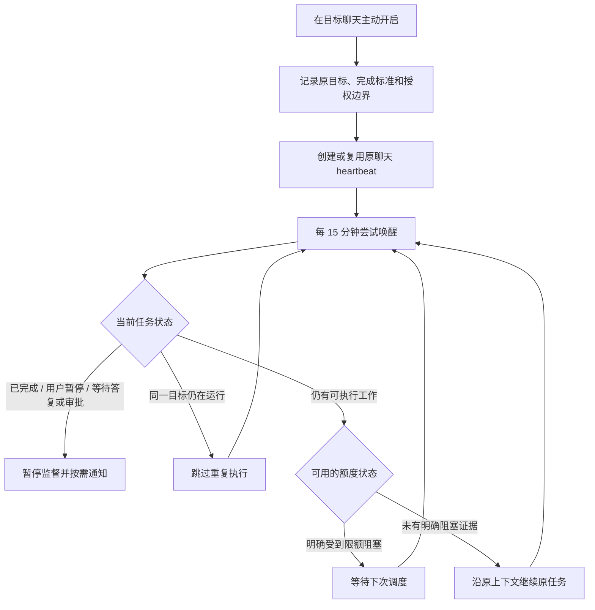

# Codex Auto Continue

让 Codex 桌面版在原聊天中每 15 分钟尝试继续未完成任务的 Skill。

**实验性方案：基于聊天内 heartbeat 定时重试。额度耗尽后的自动恢复尚未完成真实验收，请勿将其视为已验证的无人值守额度监控服务。**

## 为什么做这个

长任务可能在睡觉期间遇到用量限制，额度恢复后仍需要人回来输入“继续”。本项目将续跑规则封装为 Skill，配合原聊天中的定时任务，尝试减少这一步人工操作。

五小时窗口不是“每天只能使用五小时”；恢复条件应以账户实际窗口、周额度和服务状态为准。本项目不硬编码五小时后一定恢复。

## 工作方式



heartbeat 如果在启动前就被额度拒绝，Skill 无法执行检查。上图描述的是成功唤醒后的规则，不保证调度服务在限额期间持续重试。

## 安装

需要支持聊天内 heartbeat 和 `automation_update` 的 Codex 桌面环境。仅有 Codex CLI 或只能创建独立 cron 的环境不满足本技能要求。

下载仓库 ZIP，解压为 `codex-auto-continue` 文件夹，放入 `$CODEX_HOME/skills/`；未设置 `CODEX_HOME` 时，Windows 默认位置为：

```text
%USERPROFILE%\.codex\skills\codex-auto-continue\SKILL.md
```

重新打开聊天后查找 `$codex-auto-continue`。也可在支持读取本地文件的聊天中引用解压后的 `SKILL.md` 绝对路径来使用。安装文件本身不会创建或启用定时任务。

## 使用

先在聊天中明确原任务及完成标准，再发送：

```text
使用 $codex-auto-continue 为当前任务开启自动续跑。
```

查看和关闭：

```text
使用 $codex-auto-continue 查看当前聊天的续跑状态。
使用 $codex-auto-continue 关闭当前聊天的自动续跑。
```

默认每 15 分钟尝试一次，重复开启应更新已有记录。原任务完成、用户暂停/取消、需要答复或审批、出现无法自主解决的阻塞时暂停监督。仅在完成、新故障或需要用户操作时通知。

## 条件与限制

- 电脑保持开机、联网，Codex 桌面应用保持运行；电脑休眠和应用退出期间不承诺执行。
- 不购买额度、不兑换重置次数、不切换账号、模型、计费方式或权限；沿用原任务授权。
- 定时运行本身可能消耗额度；不是独立常驻监控，也不保证额度恢复后立即执行。
- 不能在用户审批、等待用户回答或计划模式限制下擅自继续。
- 已配置 ACTIVE 不等于实际运行成功；查看状态时应区分配置与真实执行证据。

## 验证状态

| 检查 | 状态 |
| --- | --- |
| 官方 Skill 格式校验 | 已通过 |
| UI 元数据与引用文件检查 | 已通过 |
| 创建、查看、暂停、重新启用 heartbeat | 已通过配置验证 |
| 聊天绑定、15 分钟间隔、单个启用记录 | 已通过配置验证 |
| 真实定时触发并继续原上下文 | 待验证 |
| 任务完成和审批场景的实际自动停用 | 待验证 |
| 额度耗尽 → 后续调度存续 → 恢复后续跑 | **待验证** |

详细验收步骤见 [验证记录](references/validation.md)，设计和开发过程见 [从问题到 Skill](docs/development-process.md)。本仓库不包含账户凭据、个人聊天记录、真实聊天 ID 或本机 automation 配置。

## 文件

```text
SKILL.md                         技能入口及操作规则
agents/openai.yaml               技能展示信息
references/heartbeat-prompt.md   定时任务提示词模板
references/validation.md         验证结果和验收步骤
docs/development-process.md      需求、方案取舍和实现过程
```

## 参考

- [官方 Scheduled tasks 文档](https://learn.chatgpt.com/docs/automations)：聊天内定时任务与本地运行条件。
- [官方 App Server 文档](https://learn.chatgpt.com/docs/app-server)：额度读取与会话接口，供后续研究独立后台程序使用；当前实现不使用该通道续跑。
- [openai/codex #43605](https://github.com/openai/codex/issues/43605)：CLI 场景的同类功能请求，不是桌面方案已可用的证明。

本项目为个人实验，不是 OpenAI 官方功能或服务保证。
